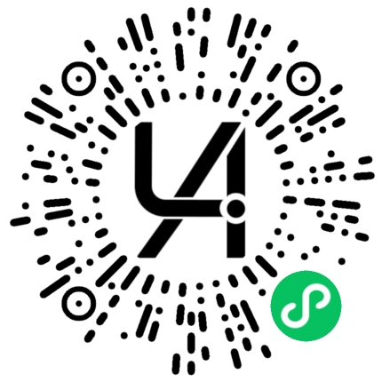
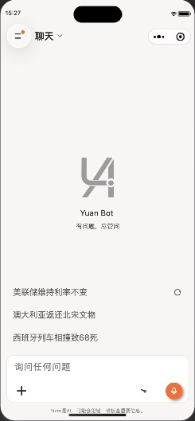
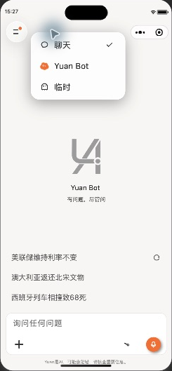
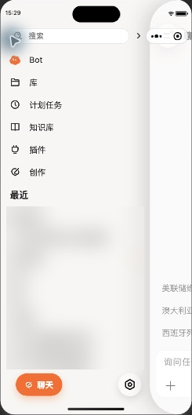
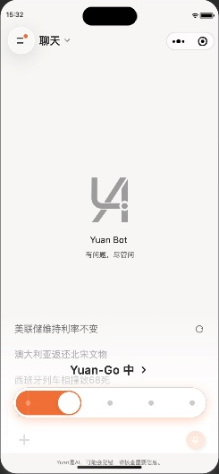
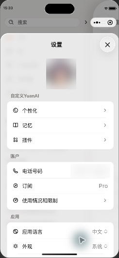
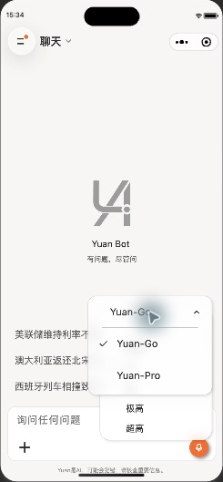

# YuanAI UI

  
   微信扫码体验

YuanAI UI 是一个基于微信小程序原生 Skyline 和 Worklet 构建的 AI 对话界面，关注页面转场、浮层、手势和流式内容展示。项目提供聊天、历史会话、文件与知识库、图片创作和个性化设置等界面，也可以作为小程序交互设计与实现的参考。

本仓库提供小程序客户端，后端、模型服务和线上服务权限不包含在内。聊天、文件、知识库、工具等完整能力依赖配套服务及相应授权；需要联调或商业合作，请通过 [GitHub Issues](https://github.com/wuhanjieyue/YuanAI-Mini/issues) 联系作者，请勿在公开 Issue 中发送密钥、Token 或个人数据。

## 界面与交互

### 弹窗页面路由

设置、详情等页面通过自定义路由以半屏形式展开，支持遮罩关闭、手势退场和多层页面叠加；试用页使用更紧凑的底部弹窗。转场使用 Skyline 与 Worklet 实现，让页面与交互动画保持协调。

### Flyout 浮层与多层选项

Flyout 根据触发位置和可用空间定位，支持滚动内容、长按预览与入场动画，适合承载操作菜单和内容预览。多级选项弹窗支持逐级选择、返回和卡片联动，方便浏览层级较深的选项。

### 侧边路由与手势

侧边栏提供历史聊天和常用入口。打开或拖动时，首页卡片与侧栏共享位移状态，配合圆角变化完成侧边页面交接；聊天列表支持长按预览和操作。

### 玻璃质感与动态反馈

部分浮层使用半透明主题色、背景模糊与圆角，呈现轻盈的玻璃质感；页面、弹窗和选择控件结合手势与动画反馈。项目同时支持深浅外观、重点色和触觉反馈设置。

### 聊天与内容展示

聊天界面支持多模型和思考程度选择、流式回复、处理过程和来源展示，以及停止、重新生成和聊天分支。Markdown 展示包括代码、表格、公式、图表和图片。Yuan Bot 入口目前为开发中的本地占位交互，尚未接入云端助理。

## 界面预览

以下画面截取自微信开发者工具；侧边栏历史记录以及设置页的头像、号码已模糊处理。

| 聊天界面 | 模式选择弹窗 | 侧边栏 |
| --- | --- | --- |
|  |  |  |

| 思考程度选择 | 设置半屏 | 多级选项弹窗 |
| --- | --- | --- |
|  |  |  |

## Agent 能力

配套后端支持 Agent Loop，在模型与工具之间循环处理任务；可按需使用 Skill 和已授权的 MCP 服务，并通过沙箱执行受控的代码与文件操作。客户端提供相关的浏览、选择与使用界面；实际能力取决于后端配置、账户权限和可用服务。后端及沙箱源码不包含在本仓库中。

## 必要配置

| 文件 | 配置说明 |
| --- | --- |
| `app_config.private.js` | 复制 `app_config.private.example.js`，填写后端地址 `apiBaseUrl` 和静态资源地址 `appStaticRoot` |
| `project.config.json` | 使用自己的微信小程序 AppID；公开配置以 `touristappid` 占位 |
| `project.private.config.json` | 复制 `project.private.config.example.json`，保留 `compileHotReLoad: false` |

公式和流程图使用 `${apiBaseUrl}/markdown-render` 统一入口，无需另配渲染服务地址；实际可用性取决于后端配置与运行状态。界面所需云素材并未全部包含在 `static/` 中。真机和正式环境需使用 HTTPS，并配置微信小程序合法域名。

本地私有配置已加入忽略规则，请勿提交。小程序代码会分发到设备，不应存放模型 API Key、微信 AppSecret 或服务端密钥。

## 许可与声明

本项目供学习与交流参考，自有代码采用 [PolyForm Noncommercial 1.0.0](LICENSE) 许可，商业使用请联系作者另行授权。第三方代码继续适用各自许可证，详见 [第三方来源与修改说明](THIRD_PARTY_NOTICES.md)、[许可证全文](THIRD_PARTY_LICENSES.md)和 [NOTICE](NOTICE)。

此前按 Apache-2.0 授权发布的版本，其既有授权不因本次变更而撤销。使用 YuanAI 名称或 Logo、接入作者后端及使用其他未授权资源，请联系作者。

使用者应遵守适用法律法规，并对自己的使用行为负责。项目按“原样”提供，不附带担保。

感谢 Towxml、MobX 小程序生态、markdown-it、highlight.js、ECharts 及相关依赖。
